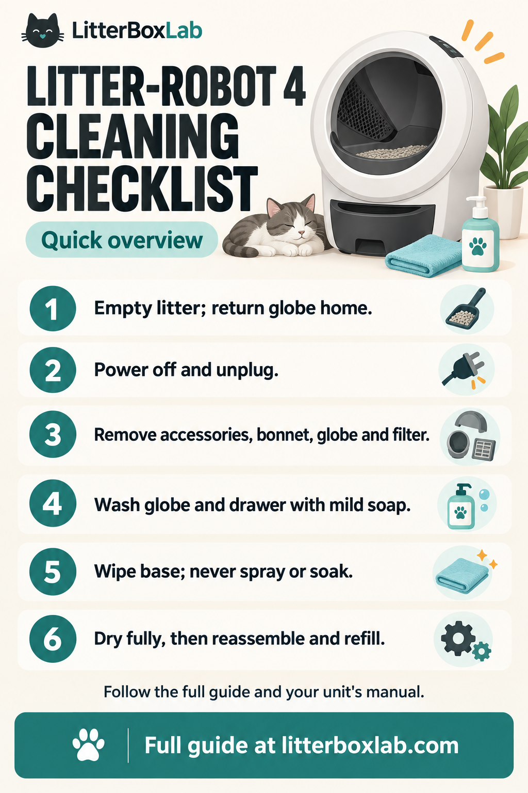

# Litter-Robot 4 Care Checklists

A downloadable cleaning checklist and sourced care notes published by [LitterBoxLab](https://litterboxlab.com/).

[Open or download the checklist image](litter-robot-4-cleaning-checklist.png)

## Six-step cleaning checklist

Keep cats away while cleaning. Follow the current instructions for your unit and accessories.

1. **Empty the litter.** Run Empty with the unit assembled, then return the globe to Home.
2. **Power off and unplug.** Disconnect power before opening the unit.
3. **Remove parts.** Remove accessories, open the bonnet, lift out the globe and remove its carbon filter as directed.
4. **Wash the globe and drawer.** Use water and mild soap; rinse away residue. Avoid bleach inside the globe.
5. **Wipe the base.** Use a damp cloth as directed. Never spray, soak or submerge the base or control panel.
6. **Dry and reassemble.** Let washed parts dry completely. Check globe seating and bonnet latches, reinstall accessories, fit the drawer liner flat and refill with compatible litter to the fill line.

## Cleaning schedule

Whisker recommends basic globe cleaning every 1–3 months and deep cleaning at least every three months, with more frequent cleaning as needed.

## Sources and further reading

- [Complete LitterBoxLab cleaning guide](https://litterboxlab.com/how-to-clean-litter-robot-4/)
- [Whisker's official Litter-Robot 4 deep-cleaning instructions](https://www.litter-robot.com/support/article/litter-robot-4-deep-cleaning/)

Manufacturer instructions checked on October 6, 2026.

This independent publisher resource summarizes researched guidance. The checklist image is an illustration. Follow the current manufacturer instructions for your model and accessories.
